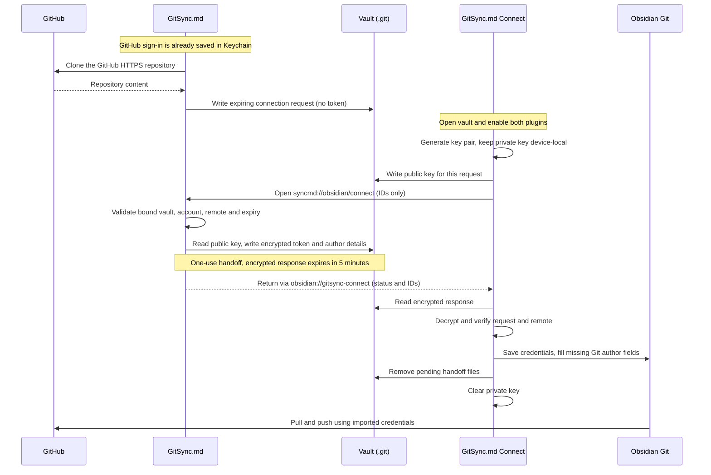

# GitSync.md Connect

A companion community plugin for Obsidian on iPhone and iPad. Sign into GitHub in GitSync.md, clone a repository, then let this plugin configure Obsidian Git without asking for another GitHub sign-in.

## Install

Version [0.1.2](https://github.com/CodyBontecou/gitsync-obsidian-connect/releases/tag/0.1.2) is available for manual installation. Its [community directory entry](https://community.obsidian.md/plugins/gitsync-connect) is live, and all automated checks pass for 0.1.2, including byte-for-byte build verification.

**App compatibility:** this plugin requires a GitSync.md app build containing the companion handoff. The tested development build was 2.6.0; the public 2.6.0 version number alone does not establish support. GitSync.md 2.8.0 build 202610141413 contains this support and has been uploaded to App Store Connect; it has not yet been submitted to Apple App Review or released publicly. Installing the plugin alone does not add handoff support to an older app.

Download [main.js](https://github.com/CodyBontecou/gitsync-obsidian-connect/releases/download/0.1.2/main.js) and [manifest.json](https://github.com/CodyBontecou/gitsync-obsidian-connect/releases/download/0.1.2/manifest.json) from the release. Users do not need Node or a build tool. Developers can build locally with `npm run release:prepare`. See [release instructions](RELEASE.md).

1. Create a `gitsync-connect` folder inside your vault's `.obsidian/plugins/` directory.
2. Copy the downloaded `main.js` and `manifest.json` into that folder. Keep both filenames unchanged.
3. In Obsidian 1.8.7 or later, enable community plugins, install and enable **Git** by Vinzent, and enable **GitSync.md Connect**. If installing manually on iOS, use a computer or a file manager that can access the vault's hidden `.obsidian` directory.
4. In the updated GitSync.md app, sign into GitHub and clone the vault into a local folder Obsidian can open. Open the cloned folder as a vault. If the repo doesn't already contain the plugin files, install the companion and Git in this new vault as well.
5. Once both plugins are enabled, the companion automatically opens GitSync.md. GitSync.md writes an encrypted response and returns to Obsidian, which imports the credentials and fills in missing Git author name/email from GitSync.md. No second sign-in or token copy is needed.

You can install the companion after cloning: connection requests remain valid for seven days. The app prepares requests for GitHub HTTPS clones authenticated with its GitHub OAuth/PAT account; opening that repository as an Obsidian vault activates the handoff. Public unauthenticated, SSH, non-GitHub and per-repo HTTPS-token clones are excluded. The vault must use a regular `.git` directory at its root, without custom Git directory/base-path settings or alternate push destinations.

## How your sign-in connects

Sign into GitHub in GitSync.md once, then open the cloned vault in Obsidian with both plugins enabled. The companion connects Obsidian Git through this local handoff:

No token is placed in an app-switch URL or a tracked vault file. Nonsecret connection metadata stays under `.git` for explicit reconnection. Existing Git credentials are preserved unless you choose **Reconnect this vault**. Obsidian Git stores its own imported copy: signing out of GitSync.md does not clear that copy. See [Credential handling](#credential-handling) for storage and revocation details.

## Commands and troubleshooting

- **Connect this vault** renews the connection request and retries an interrupted connection. Reopen the vault after enabling Git if its initialization is still underway.
- **Reconnect this vault (replace existing Git credentials)** renews the connection request and explicitly permits replacing existing credentials. Automatic connection preserves existing credentials.
- If a request has expired or has already been consumed and you need a new token, sign into the appropriate account in GitSync.md and run Reconnect this vault. This preserves your working copy. The preview does not perform background token refresh or automatically revoke the imported token when signing out of GitSync.md.
- An encrypted response expires after five minutes. If Obsidian cannot import it within that time, run Connect this vault to renew the request.
- Obsidian Git 2.41.1's device-local credential API is supported. The upcoming `gitServerPassword` API is detected and used when available. These are plugin internals, so future Obsidian Git changes may require a companion update.
- This preview connects credentials; it does not configure automatic sync intervals, install Git for you, or change Obsidian Git's mobile Git implementation.

## Accounts, network use, and cost

The companion is free and MIT licensed. It requires the separate GitSync.md iOS app, a GitHub account authenticated in that app, and the Git community plugin by Vinzent. GitSync.md is a separate product with its own pricing and feature availability; see [gitsync.md](https://gitsync.md). No additional account or subscription is created by this companion.

This companion makes no direct HTTP requests. It switches between Obsidian and GitSync.md using local URL schemes and exchanges encrypted data inside the selected vault. GitSync.md uses GitHub for authentication and cloning; Obsidian Git uses GitHub for repository operations such as pull and push. The companion does not read files outside the vault, collect analytics, install other plugins, or update itself. GitSync.md is a separate native application; the included Swift file is the handoff implementation used for protocol tests, not the complete app source.

## Credential handling

GitSync.md retains its original token in Keychain. It stores a nonsecret, expiring request under `.git/gitsync-obsidian/`, with a separate native binding to the repository and granted folder. The companion generates a P-256 key pair using Web Crypto and stores its private key in Obsidian's per-vault, device-local storage. Only its public key goes into the vault.

The companion opens `syncmd://obsidian/connect` with repository/request IDs and the vault name. The app checks its native binding, granted folder, request lifetime, auth method and unchanged GitHub HTTPS origin. It reads the public key from that same folder, encrypts the token with ephemeral P-256 ECDH, HKDF-SHA256 and AES-256-GCM, writes `response.json`, and consumes the native binding. The callback to `obsidian://gitsync-connect` contains only status, vault and request ID. Tokens and private keys never appear in callback URLs.

Obsidian verifies and decrypts the response, then fills missing repository author fields from the clone configuration and configures Git's device-local credential storage (2.41.1) or its secret storage API (when available). After successful import it removes the request, recipient and encrypted response, then clears the private key. Nonsecret `connection.json` metadata remains under `.git` to support explicit reconnection without another clone. Pending files live under `.git`, so normal Git staging cannot commit them. Neither app sends credentials to a new server.

The imported token has the same permissions as the GitSync.md token. Obsidian Git 2.41.1 stores it in device-local browser storage, not an OS Keychain; the companion does not improve that plugin's storage guarantees. Enabled plugins and applications with access to the vault are trusted participants. OAuth token revocation or expiry affects both clients. GitSync.md sign-out does not remove Obsidian's imported copy; revoke the token in GitHub or clear it in Obsidian Git to disconnect both.

## Development and validation

`npm test` runs Node tests and compiles a Swift/CryptoKit fixture using the macOS Xcode toolchain. It exercises the actual Swift producer against the JavaScript consumer, credential installation for both storage APIs, cleanup/replay rejection, token overwrite protection, expiry, ciphertext tampering, wrong keys, changed origin URLs, ambiguous Git config and symlink rejection. All credentials in fixtures are fictional.

`npm run build` uses Node alone to produce the dependency-free mobile-compatible CommonJS bundle and installation folder. `npm run release:prepare` additionally creates optional development ZIPs and checksums and requires the zip command. `src/connection.js` is the protocol/crypto implementation; `src/main.js` wires Obsidian lifecycle, commands and URL callbacks. No Node APIs are used in the plugin runtime.

The initial candidate passed the app-switch round trip and a real private-repository pull and push on a physical iPhone. Before each release, verify the app-switch round trip and a real Obsidian Git pull/push on an iPhone with a disposable private GitHub vault. Automated tests do not establish real-device Obsidian lifecycle behavior.

Credential APIs were checked against [Obsidian Git 2.41.1](https://github.com/Vinzent03/obsidian-git/blob/2.41.1/src/setting/localStorageSettings.ts), its [upcoming secret storage implementation](https://github.com/Vinzent03/obsidian-git/blob/master/src/setting/gitServerPassword.ts), and the [Obsidian API](https://github.com/obsidianmd/obsidian-api/blob/master/obsidian.d.ts).

## License

[MIT](LICENSE). See [CHANGELOG](CHANGELOG.md) for changes.
